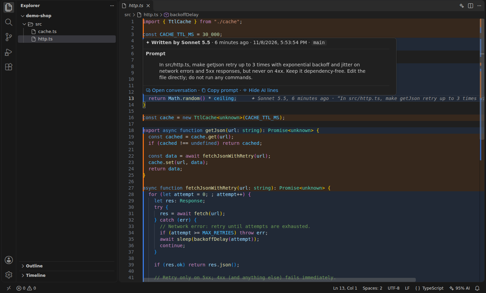
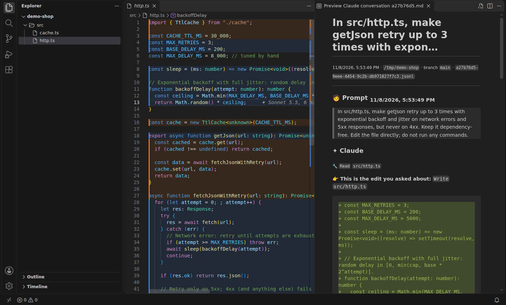

# Prompt Blame

**`git blame` for AI code.** Hover any line in VS Code and see the Claude Code prompt that produced it, what Claude said
while writing it, and the whole conversation one click away.

[](https://github.com/AndreaAcanfora/prompt-blame/actions/workflows/ci.yml)
[](LICENSE)



`git blame` says *you* wrote that retry loop at 23:12. It doesn't say it came from
"make getJson retry with exponential backoff, but never on 4xx", or that Claude had a reason for the jitter.
After a few weeks of agent-driven work, nobody remembers why half the code looks the way it does.

Prompt Blame reads the transcripts Claude Code **already keeps on your disk** (`~/.claude/projects`) and matches every
edit Claude made against the current file:

- **Zero setup.** No hooks, no proxy, no git notes, no account. Install it and it works on code you wrote last week.
- **Exact, not guessed.** A line is attributed only if its text is still exactly what an `Edit`, `Write` or `MultiEdit`
  call wrote. Lines you changed afterwards go back to being yours (line 6 in the screenshot).
- **Local.** It only reads files on your machine. Nothing is sent anywhere.

## Features

**Current line:** who wrote the line under the cursor, when, and the prompt, at the end of the line.

**Hover:** the full prompt, Claude's note right before the edit, model, branch and time, with
*Open conversation* and *Copy prompt*.

**Highlights:** click `✦ 95% AI` in the status bar (or the ✦ button in the editor title) to tint every line Claude wrote, one color per prompt.

**Conversation view:** the turn that produced the line, with the diff of that exact edit and the prompts around it.



**File report:** *Prompt Blame: Show AI Report for This File* lists every prompt that still has lines in the file. Handy in code review.

## CLI

The same engine works in a terminal, in CI or over SSH:

```console
$ prompt-blame src/http.ts
#2 ▌ 1  import { TtlCache } from "./cache";
   ▌ 2
   ▌ 3  const CACHE_TTL_MS = 30_000;
#1 ▌ 4  const MAX_RETRIES = 3;
   ▌ 5  const BASE_DELAY_MS = 200;
     6  const MAX_DELAY_MS = 8_000; // tuned by hand
     7
#1 ▌ 8  const sleep = (ms: number) => new Promise<void>((resolve) => setTimeout(resolve, ms));
...
37 of 39 non-blank lines (95%) are exactly as Claude wrote them

#1  6 minutes ago · Sonnet 5.5 · session a27b76d5
    “In src/http.ts, make getJson retry up to 3 times with exponential backoff and jitter on network errors and 5x…”
#2  6 minutes ago · Sonnet 5.5 · session a27b76d5
    “Add a small in-memory TTL cache in a new file src/cache.ts (get/set/delete, lazy expiry), and use it in getJs…”

$ prompt-blame src/http.ts:12      # full prompt, Claude's note and the diff for one line
$ prompt-blame stats .             # how much of each file is still exactly as Claude wrote it
  95%  ███████████████████░     37/39     src/http.ts
 100%  ████████████████████     24/24     src/cache.ts
```

Add `--json` for machine-readable output.

## Install

Prompt Blame is not on the Marketplace yet. Download `prompt-blame-0.1.0.vsix` from the
[latest release](https://github.com/AndreaAcanfora/prompt-blame/releases/latest), then:

```sh
code --install-extension prompt-blame-0.1.0.vsix
```

or in VS Code: Extensions view → `…` → *Install from VSIX…*. It needs VS Code 1.85 or later, on the same machine
where Claude Code runs. Forks such as Cursor or VSCodium should work too, but are not tested yet.

The CLI needs Node 18+:

```sh
git clone https://github.com/AndreaAcanfora/prompt-blame && cd prompt-blame
npm ci && npm run build && npm link     # then: prompt-blame <file>
```

## Settings

| Setting | Default | |
|---|---|---|
| `promptBlame.currentLine` | `true` | Annotation at the end of the current line |
| `promptBlame.hover` | `true` | Prompt on hover |
| `promptBlame.highlight` | `false` | Start with AI lines highlighted |
| `promptBlame.titleButton` | `true` | ✦ toggle in the editor title bar |
| `promptBlame.claudeDir` | `""` | Claude Code config dir (default `$CLAUDE_CONFIG_DIR` or `~/.claude`) |
| `promptBlame.refreshSeconds` | `5` | How often to pick up new transcript entries |
| `promptBlame.conversationContext` | `2` | Prompts shown before and after the edit in the conversation view |

## How it works

1. Finds the transcripts of sessions started in your workspace folder, inside it, or in a parent folder
   (including subagent transcripts), and reads them incrementally as Claude keeps working.
2. Collects every successful `Edit`, `Write` and `MultiEdit` call, and walks the conversation tree back to the prompt
   that started the turn (slash commands included; subagent edits point to the task they were given).
3. For each edit, keeps only the lines it *added* (a line diff of `old_string` → `new_string`), then matches them
   against the current file, ignoring indentation. When several edits wrote the same text, the one that also wrote the
   neighbouring lines wins, then the most recent. Blank lines and lone braces are attributed only inside a block that agrees.

## Limits

- **Transcripts expire.** Claude Code deletes transcripts older than 30 days by default. To keep the history,
  raise [`cleanupPeriodDays`](https://code.claude.com/docs/en/settings) in `~/.claude/settings.json`, e.g. `"cleanupPeriodDays": 365`.
- **Only the file tools count.** Changes Claude makes through the shell (`sed -i`, a heredoc, a code generator) are not attributed.
- **Same machine.** Code written by Claude on a teammate's laptop or in a cloud session is not on your disk.
- **Claude Code only, for now.** Other agents keep transcripts in other formats; pull requests for Codex, Gemini CLI or Cursor are welcome.

## Development

```sh
npm ci
npm test                    # unit tests
npm run test:integration    # runs a real VS Code (needs a display; use xvfb-run on Linux)
npm run watch               # then F5 in VS Code to launch the Extension Development Host
```

The screenshots come from `node scripts/integration.mjs --demo <file> <line> <prompt>`, which drives a real VS Code
over a small project Claude Code wrote for the occasion.

## License

[MIT](LICENSE)
